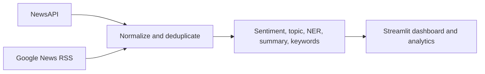

# News-melt-AI

Streamlit dashboard that collects current headlines from NewsAPI and Google News RSS, then runs sentiment analysis, zero-shot topic classification, summarization, named entity extraction, keyword trends, and visual analytics.

## Problem and objective

News arrives across multiple feeds and is difficult to scan quickly. The project brings source links and lightweight NLP signals into one view so users can browse themes, sentiment, entities, and article summaries. It is an analysis aid; model labels and summaries should be checked against the linked article.

## Features and data flow

NewsAPI/RSS records are normalized into one article shape, deduplicated in input order, analyzed by cached NLP models, and shown in the Articles, Analytics, Trending, Entities, and Word Cloud tabs. RSS descriptions are snippets; they are not represented as full article text.



## Repository layout

- `app.py`: Streamlit dashboard.
- `src/collectors`: NewsAPI and RSS clients.
- `src/nlp`: NLP models and keyword utilities.
- `src/utils`: article normalization, deduplication, date and text helpers, file cache.
- `evaluation/`: standalone benchmark and common-news preparation scripts; historical reports are retained in `evaluation/results/`.
- `docs/`: audit, architecture, evaluation, security, validation, and deployment notes.

## Models and sources

- Sentiment: `distilbert-base-uncased-finetuned-sst-2-english`; production may fall back to TextBlob when transformer load/inference fails.
- Topic: `facebook/bart-large-mnli`; production may fall back to keywords.
- Summary: `facebook/bart-large-cnn`; production may fall back to first sentences.
- NER: spaCy `en_core_web_sm`.
- Collection: NewsAPI (key required) and public Google News RSS feeds.

The classifiers operate on English text and have limited context. Fresh benchmarks currently include 500 SST-2 sentiment examples (91.20% accuracy), 100 AG News examples (82.00%), 10 CNN/DailyMail summaries (ROUGE-1 41.74%), 500 CoNLL NER sentences (micro F1 60.19%), and 500 Inspec keyword examples (F1@5 3.19%). See [evaluation report](docs/EVALUATION_REPORT.md) for provenance and limits. Model weights download on first use and are not committed.

## Setup

Python 3.10 is the verified local environment. Install application dependencies and spaCy model:

```powershell
python -m venv .venv
.\.venv\Scripts\Activate.ps1
python -m pip install -r requirements.txt
python -m spacy download en_core_web_sm
Copy-Item .env.example .env
```

In `.env`, set `NEWS_API_KEY` to a valid NewsAPI key. The app can run with RSS alone if the NewsAPI key is omitted. Never publish `.env` or paste secrets into issue reports.

Git Bash equivalent:

```bash
python -m venv .venv
source .venv/Scripts/activate
python -m pip install -r requirements.txt
python -m spacy download en_core_web_sm
cp .env.example .env
```

Run with `streamlit run app.py`.

## Evaluation

Install evaluation-only packages with `pip install -r requirements-evaluation.txt`. Dataset/model evaluation may require substantial downloads, RAM, and network access. Run commands from the repository root:

```powershell
python evaluation/evaluate_sentiment.py
python evaluation/evaluate_classifier.py
python evaluation/evaluate_summarizer.py
python evaluation/evaluate_ner.py
python evaluation/evaluate_keywords.py
python evaluation/evaluate_common_news.py --prepare --sample-size 150
```

The common-news script prepares a stable CNN/DailyMail 3.0.0 test subset and blank annotation template; no sentiment/topic/entity/keyword labels are supplied by that dataset. See [evaluation guide](evaluation/EVALUATION_GUIDE.md). Reported benchmark results measure their stated datasets only and do not establish equivalent performance on current news.

Dataset use and attribution: GLUE SST-2, AG News, CoNLL-2003, CNN/DailyMail, and Inspec are external datasets with separate terms and citations. Review each dataset card/license before redistribution. The CNN/DailyMail dataset has article text, highlights, and IDs; it has no labels for sentiment/topic/NER/keywords. Inspec is academic abstracts and is a domain-mismatched keyword baseline.

## Deployment

Deployment has not been performed. Streamlit Community Cloud is a candidate, but the large Torch/Transformers dependencies and model cold-start/resource needs must be checked in a deployment build. See [deployment notes](docs/DEPLOYMENT.md) for repository, secrets, model, and smoke-test steps.

## Limitations and troubleshooting

- API availability, quotas, RSS feed changes, and model downloads depend on external services.
- NewsAPI can return truncated article bodies; RSS generally returns snippets.
- TextBlob and keyword fallbacks have different behavior from the intended transformers.
- ROUGE is lexical overlap, not factuality. News-facing sentiment/topic/NER require manually annotated news examples.
- If NewsAPI credentials are missing, use RSS or configure `NEWS_API_KEY`.
- If models fail to load, check internet access, free disk space, PyTorch compatibility, and Hugging Face cache permissions. spaCy NER requires `en_core_web_sm`.

## Security

Collector content is untrusted. User-supplied article fields are escaped before HTML rendering, and external article links are restricted to HTTP(S). See [security review](docs/SECURITY_REVIEW.md).
