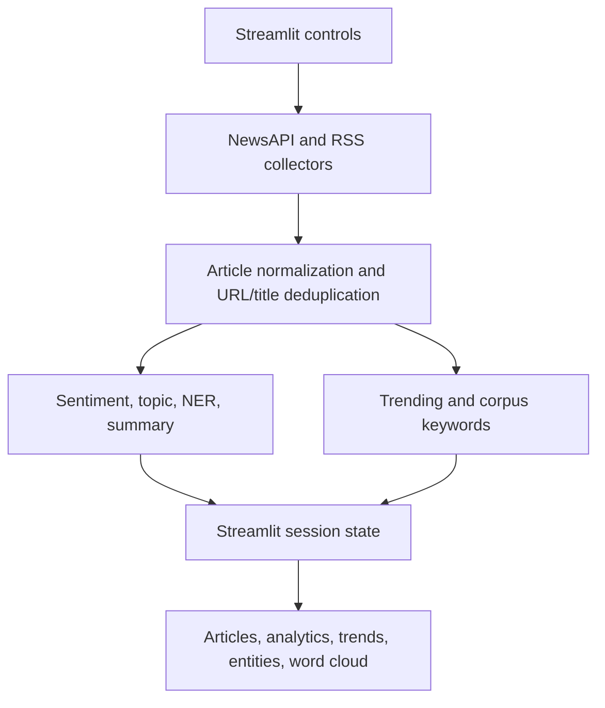

# Architecture

Collectors map source fields into a stable record with title, description, content, URL, source, nullable ISO date, image URL, collector, and nullable NLP outputs. RSS snippets stay in `description`; `content` remains empty because feeds do not establish that the snippet is a full article. Deduplication preserves order, normalizes scheme/host case, removes trailing path slashes, preserves path case and query parameters, and does not discard fragments. If URL is absent, normalized title is used; records with neither are retained.

Model objects are loaded once per Python process through `lru_cache`. Production functions can use fallbacks. The dashboard caches collection for 15 minutes through Streamlit `cache_data`; the JSON disk cache utility is not currently connected to app collection.
